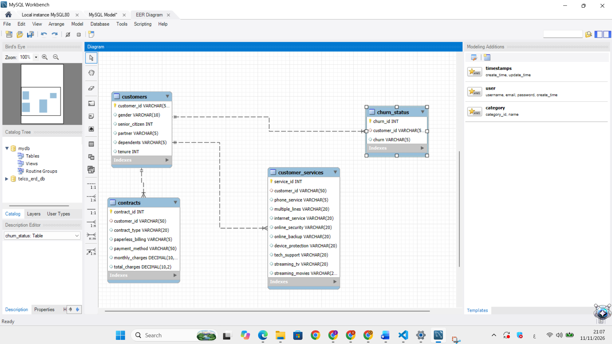

# Telco Customer Churn Analysis

An exploratory data analysis project that investigates customer churn in a telecommunications company using Python, SQL, and MySQL.

## Project Overview

Customer churn is one of the main challenges faced by telecommunication companies. This project analyzes customer information, services, contracts, charges, and churn status to identify patterns related to customer attrition.

## Project Objectives

- Calculate the overall customer churn rate.
- Analyze churn by contract type.
- Compare monthly charges between churned and retained customers.
- Study the effect of customer tenure on churn.
- Analyze churn by payment method and internet service.
- Examine whether technical support and online security are related to churn.
- Create SQL queries for business analysis.

## Dataset

The dataset contains information about 7,043 customers and 21 features, including:

- Customer demographics
- Phone and internet services
- Contract details
- Payment methods
- Monthly charges
- Total charges
- Churn status

## Tools and Technologies

- Python
- Pandas
- NumPy
- Matplotlib
- Seaborn
- Jupyter Notebook
- MySQL
- MySQL Workbench

## Project Files

| File | Description |
|---|---|
| `project1.ipynb` | Data cleaning and exploratory data analysis |
| `Telco_Customer_Churn_Queries.sql` | Database creation and SQL analysis queries |
| `ERD.sql` | SQL script for creating the normalized database schema |
| `ERD.png` | Entity Relationship Diagram |

## Data Cleaning

The following data preparation steps were performed:

- Inspected data types and missing values.
- Converted `TotalCharges` from text to numeric format.
- Handled blank values in `TotalCharges`.
- Standardized column names.
- Examined numerical statistics.
- Prepared the data for analysis and visualization.

## Analysis Performed

The project includes analysis of:

- Overall churn rate
- Churn by contract type
- Monthly charges by churn status
- Customer tenure
- Internet service type
- Payment method
- Technical support
- Online security
- Correlation between numerical variables

## Database Design

The database schema was designed using MySQL Workbench.

The database separates:

- Customer information
- Contracts and billing
- Customer services
- Churn status

The schema files are:

- `ERD.sql`: SQL script for creating the database schema.
- `ERD.png`: Entity Relationship Diagram.

To create the database, open `ERD.sql` in MySQL Workbench and run it.



## Visualizations

### Churn Rate by Contract Type

If you upload the chart inside an `images` folder, use:

```markdown

